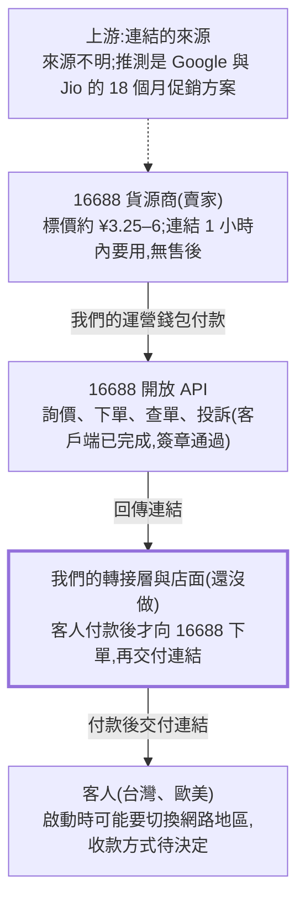

# 代儲貨源研究:16688 對接與實測

Oct 16, 2026 · @Regent Wang

## 結論

貨源可行,技術對接已打通,但還沒用真錢下過單。16688 平台上的 Google AI Pro(Gemini)18 個月啟動連結,實測進貨成本約 ¥5.55(約 NT$25);台灣蝦皮同類商品約 NT$1200。

- **已確認**:16688 開放 API 可以詢價、下單、查單、投訴;我們寫的客戶端已用真憑證通過簽章驗證,詢價成功。
- **最大不確定**:所有賣家都沒說連結來源;連結 1 小時內不用就過期、無售後;福利之後會不會被 Google 或 Jio 收回,沒有官方條款可查。
- **還缺的**:運營錢包是 0,尚未實際購買一份走完「下單、啟動、追蹤」流程。

## 運作方式

已查清的是 16688 這一段(貨源商、API);上游來源不明,我們自己的店面和收款還沒做。

粗框是我們要自己做的部分:客人付款後才即時向 16688 下單,因為連結 1 小時內不用就過期,不能囤貨。(Claude Docs 裡的原圖在匯出時無法保留,這裡用 Mermaid 重畫。)

## 貨源實測

實際進貨成本 = 代理價 + 2.8% 采購手續費。以下是 2026-10-16 用 API 詢價(唯讀,沒下單)的結果,匯率以 ¥1 ≈ NT$4.5 估算。

| 商品編號 | 賣家 | 貨源廣場標價 ¥ | 代理價 ¥ | 手續費 ¥ | 合計 ¥ | 庫存 |
| --- | --- | --- | --- | --- | --- | --- |
| G53296780 | 503691766@qq.com | 5.5 | 5.4 | 0.15 | **5.55**(約 NT$25) | 85 |
| G38228339 | 503691766@qq.com | 3.25 | 3.25 | — | — | **0(已售罄)** |

- 便宜的貨會缺貨:銷量 983 的 ¥3.25 商品目前買不到,所以下單要在客人付款當下才詢價,不能假設有貨。
- 若在 16688 自己的店面賣:平台服務費 2.8%,訂單凍結 24 小時,提現手續費平台承擔。自架店面則沒有這筆。

Sources: [16688 開放 API 文件](https://www.16688.com.cn/api/purchase/docs/)、[16688 商家開店指引](https://haofutech.feishu.cn/docx/ESdldD1FXouYQlxdcZycXxx2nOf)。

## 貨源評分表

在 16688 貨源廣場搜尋 Gemini,共 35 筆,以下是 18 個月啟動連結類中值得測試的 13 個。銷量只代表出貨量,不代表連結不被收回;「來源可查性」全部是低,因為沒有一家說連結從哪來。

| 賣家 | 單價 ¥ | 銷量 | 條件 | 來源可查性 | 測試結果 |
| --- | --- | --- | --- | --- | --- |
| 503691766@qq.com(JIO,1 小時過期) | 3.25 | 983 | 無售後;目前庫存 0 | 低 | 待測 |
| xucanyang01@gmail.com(JIO,5TB) | 3.5 | 1572 | 「考慮售後請提前錄屏」 | 低 | 待測 |
| 樱花AI(JIO) | 4.5 | 590 | 無說明 | 低 | 待測 |
| 奶龍Gemini訂閱(自稱源頭) | 4.8 | 6202 | 無說明 | 低 | 待測 |
| 樱花AI(argon) | 5.4 | 8389 | 無說明 | 低 | 待測 |
| 503691766@qq.com(G53296780) | 5.5 | 6597 | 1 小時有效,無售後,不退款 | 低 | 待測 |
| xucanyang01@gmail.com(JIO,5TB) | 5.5 | 3343 | 售後 1 小時,請錄屏 | 低 | 待測 |
| llcuio@163.com(自稱一手) | 6 | 259 | 無說明 | 低 | 待測 |
| ixrecur@gmail.com | 6.2 | 250 | 無說明 | 低 | 待測 |

排除:成品號(¥13–25)、虛擬信用卡、接碼、Ultra 家庭組(¥149–195),商業邏輯不同。

Sources: [16688 貨源廣場](https://www.16688.com.cn/merchant/source)(需登入,2026-10-16 搜尋 Gemini)。

## 技術對接

16688 的開放 API 已能完成詢價、下單、查單、投訴;我們寫的客戶端用真憑證詢價成功,簽章驗證通過。前端網站先不談,只管貨源。

| 端點 | 用途 | 會不會花錢 |
| --- | --- | --- |
| `purchase/quotePrice` | 詢價:單價、手續費、庫存、錢包餘額夠不夠 | 不會 |
| `purchase/create` | 下單,扣運營錢包,回傳連結 | **會** |
| `purchase/query` | 查單(沒有回調,未發貨要輪詢) | 不會 |
| `purchase/applyComplaint` | 發起投訴,需 1–6 張截圖 | 不會 |
| `goods/detail`、`goods/list` | 商品詳情、已代理的貨源清單 | 不會 |

- **簽章**:HMAC-SHA256,時間誤差上限 ±300 秒,nonce 600 秒內不可重複。
- **客戶端**:在 `source16688` 資料夾,15 個離線測試通過。「下單」指令必須設金額上限且明確確認才會扣款;憑證只放本機 `.env`,不進對話、不進文件。
- **前提**:文件寫詢價限「已代理貨源」,實測是帳號成為代理後才能用。
- **和獨角數卡的關係**:獨角數卡的「站點對接」只認另一台獨角數卡,協定與 16688 不同,沒辦法直接接。後續要寫一層轉接,或付款後直接向 16688 下單、再把連結寫進卡密庫存。

Sources: [16688 開放 API 文件](https://www.16688.com.cn/api/purchase/docs/)、[獨角數卡站點對接說明](https://dujiao-next.com/api/integration-guide)、[站點對接 API](https://dujiao-next.com/api/integration-open-api)。

**已知風險**

- **收款受限**:16688 自己的店面只收支付寶和微信,台灣與歐美客人付不了;獨角數卡沒有綠界、藍新。金流業者也可能拒絕轉售訂閱類商品,串接前要先問。

## 下一步

下一步是用約 ¥30–¥40(NT$135–180)小量購買,找出哪個賣家的連結「能啟動、期限真的是 18 個月」。

1. 充值運營錢包約 ¥30–¥40(金錢操作,由帳號擁有者自己做)。
2. 從評分表選 3–5 個賣家,每家買 1 份。用客戶端的 `buy` 指令,必須設「上限金額」且明確確認才會扣款。
3. 拿到連結後 1 小時內,用乾淨的測試 Google 帳號啟動。記錄:能否啟動、是否要切換地區、方案名稱、到期日,並截圖。
4. 故意測一次 16688 的投訴流程,看賣家多快處理,這決定我們能不能對客人承諾補發。

**後續****決定**

- [ ] 收款方式:先用 Stripe/PayPal,還是一開始就做台灣金流(綠界/藍新需自己寫支付模組)
